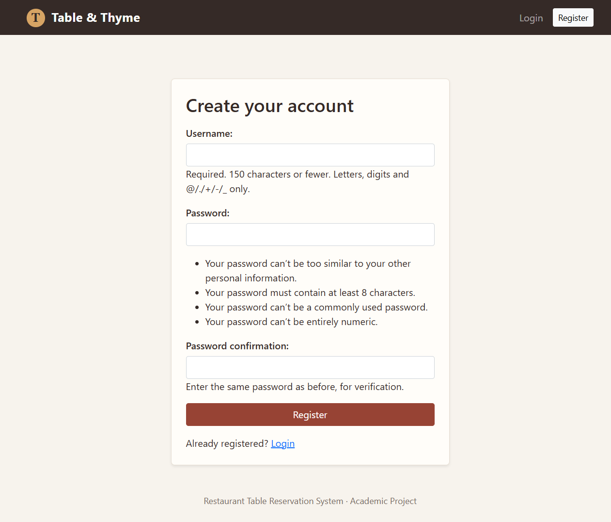
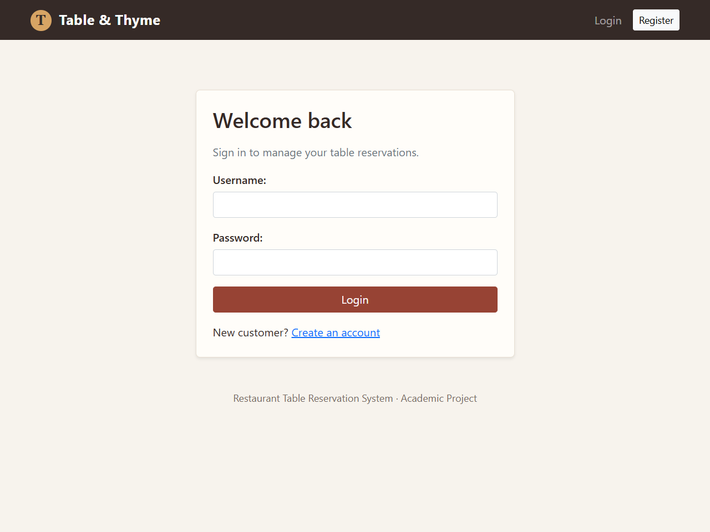
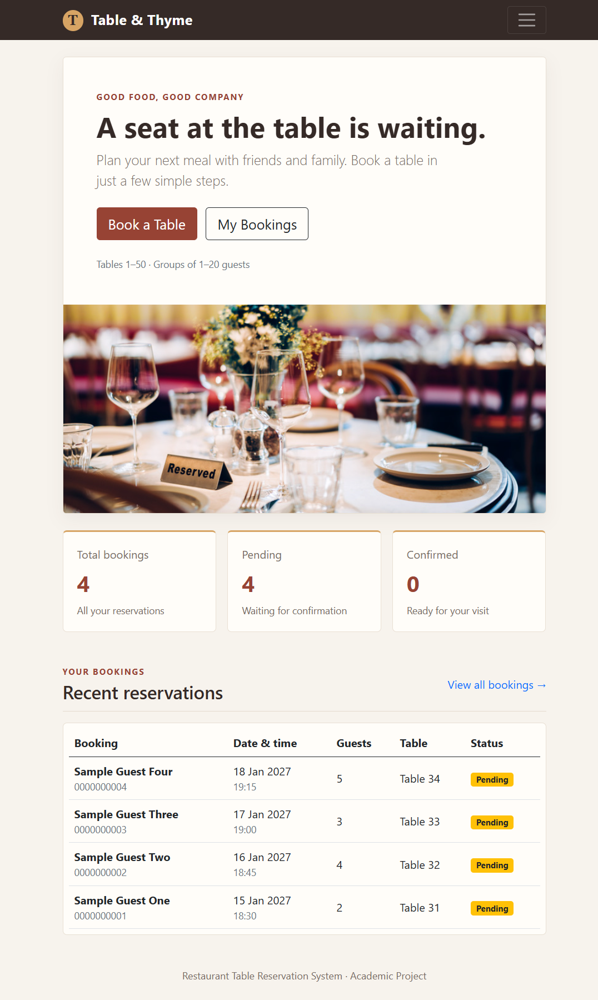
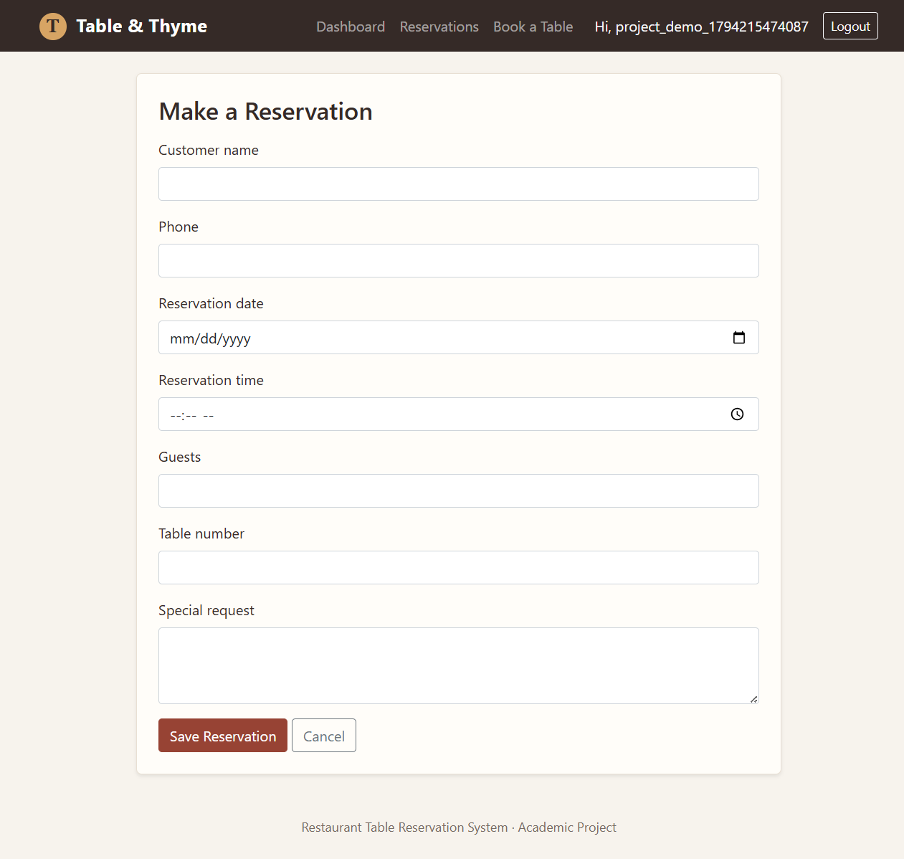
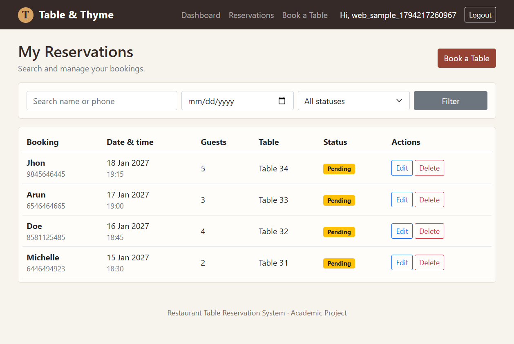
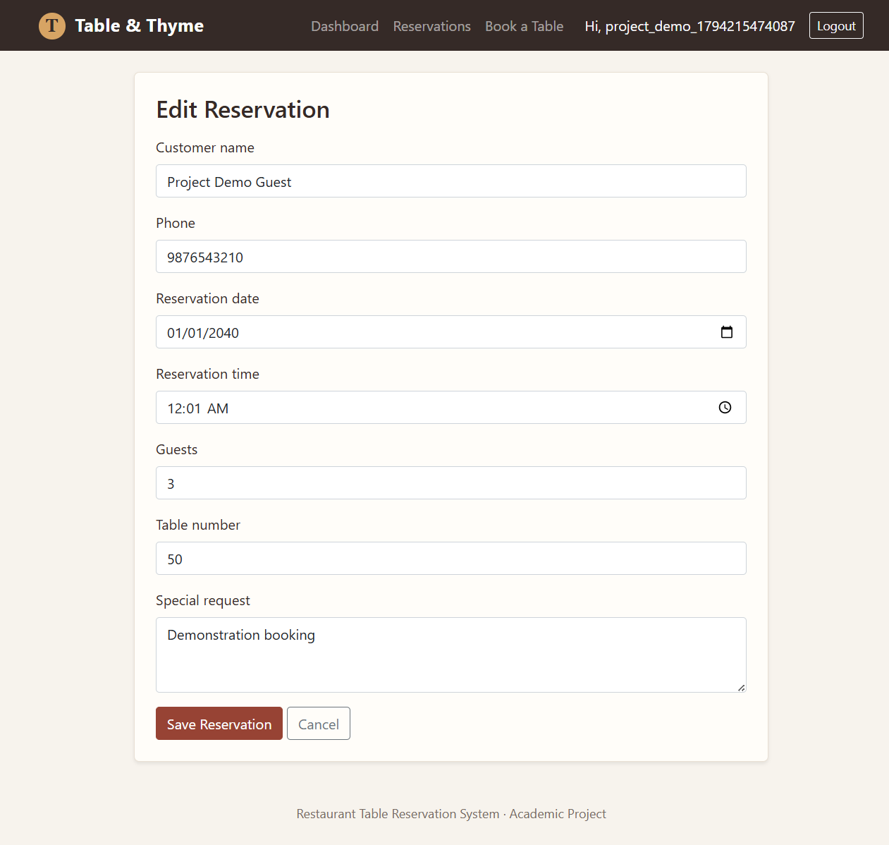
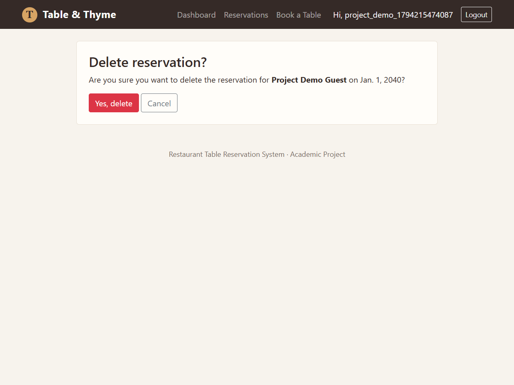
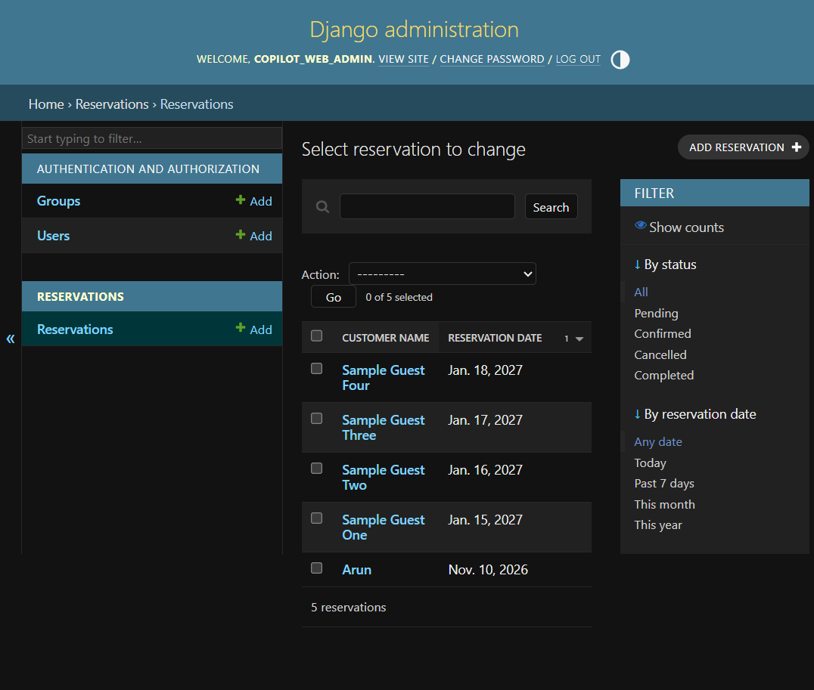
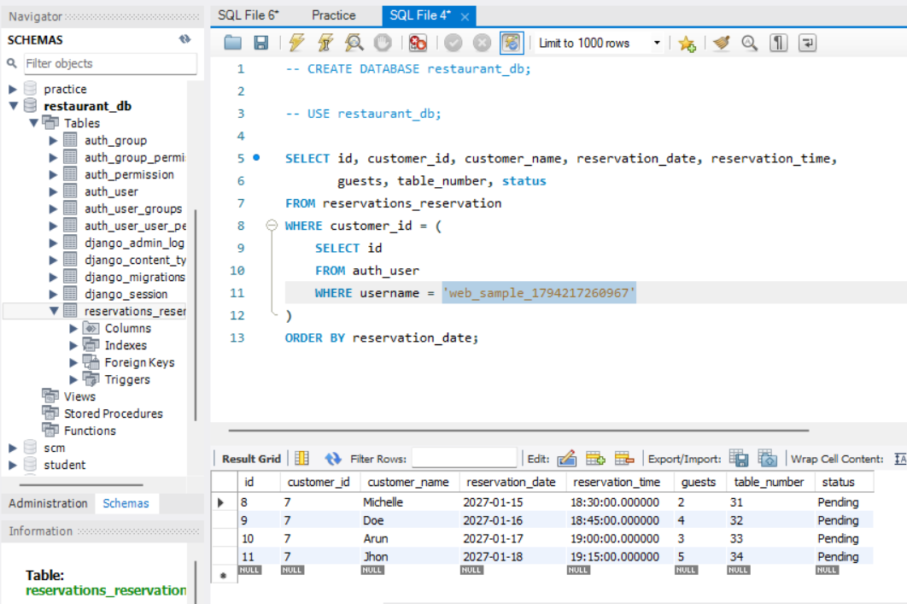

# PROJECT DOCUMENTATION
## Restaurant Table Reservation System

**GitHub Repository:** https://github.com/Selva426/Restaurant-table-reservation-system

### 1. Project Introduction
The Restaurant Table Reservation System is an individual Python full-stack project. It lets customers create accounts, log in, reserve restaurant tables, and manage their own bookings. Django handles the backend, while MySQL stores reservation data. Search and filters make bookings easier to find.

### 2. Project Objectives
- Provide customers with an online way to reserve restaurant tables.
- Reduce manual handling of reservation records.
- Let customers view, update, and delete their own bookings.
- Store reservation data in a relational database.
- Apply Python, Django, MySQL, and frontend development skills in one project.

### 3. Technologies Used
| Layer | Technology |
|---|---|
| Frontend | HTML5, CSS3, Bootstrap 5 |
| Client-side scripting | JavaScript |
| Backend | Python 3, Django 5.2 |
| Database | MySQL |
| Database adapter | PyMySQL |
| Version control | Git and GitHub |
| Development tools | VS Code, MySQL Workbench |

### 4. System Requirements
**Hardware:** Computer with at least 4 GB RAM and internet access for installing packages and loading the Bootstrap CDN.

**Software:** Windows 10/11 (or compatible OS), Python 3.10+, MySQL Server 8+, web browser, VS Code or another code editor, Git.

### 5. Database Design
The database uses Django's built-in authentication tables and a custom `reservations_reservation` table.

**Reservation fields**
| Field | Type | Description |
|---|---|---|
| id | Big integer, primary key | Unique reservation identifier |
| customer_id | Foreign key | References the Django user |
| customer_name | Varchar(100) | Name for the booking |
| phone | Varchar(15) | Contact number |
| reservation_date | Date | Booking date |
| reservation_time | Time | Booking time |
| guests | Positive small integer | Number of guests (1–20) |
| table_number | Positive small integer | Table number (1–50) |
| special_request | Text | Optional customer request |
| status | Varchar(20) | Pending, Confirmed, Cancelled or Completed |
| created_at | Date/time | Record creation timestamp |

**Relationship:** One user can create many reservations, and each reservation belongs to one user. The customer foreign key uses cascade deletion.

**Validation:** The Django form checks reservation dates and phone numbers. It also rejects a table/date/time combination that is already reserved by a non-cancelled booking.

### 6. Module Description
1. **Registration:** Django's built-in user form creates customer accounts.
2. **Login and logout:** Django authentication signs customers in and ends their sessions.
3. **Dashboard:** Displays reservation totals, status counts, and recent bookings.
4. **Reservations:** Customers can create and view their reservation records.
5. **Update:** Customers can edit their own booking details.
6. **Delete:** A confirmation page appears before a reservation is deleted.
7. **Search and filters:** Customers can search by name or phone and filter by date or status.
8. **Validation:** JavaScript provides quick client-side checks, while Django forms validate submissions on the server.
9. **Admin:** Django admin lets an authorized administrator inspect and manage reservation records.

### 7. How I Run the Project
1. Install Python and MySQL Server.
2. Create the `restaurant_db` database and `restaurant_app` user in MySQL as described in the README.
3. Create a Python virtual environment and install the packages from `requirements.txt`.
4. Copy `.env.example` to `.env` and enter local database credentials and a Django secret key. Do not commit `.env`.
5. Run `python manage.py migrate` to create the tables.
6. Run `python manage.py createsuperuser` to create an administrator account.
7. Run `python manage.py runserver` and open `http://127.0.0.1:8000/` in a browser.

### 8. Testing
Six Django workflow tests passed using an isolated in-memory SQLite test database. They cover registration/login/logout, protected pages, reservation create/update/delete, dashboard counts, name and phone search, date/status filtering, form validation, duplicate table/time prevention, cancelled bookings, and reservation ownership.

The app was also checked against the configured MySQL database. Django's system check and read-only migration check passed. Browser checks covered registration, the dashboard, reservation creation and update, phone/date/status filtering, deletion, and logout. Validation, duplicate prevention, and reservation ownership were checked by the automated tests.

The test checklist covered:
- Valid customer registration and login.
- Successful reservation creation.
- Reservation list displays saved records.
- Update and delete operations.
- Search by customer name and phone.
- Date and status filtering.
- Past date and invalid phone validation.
- Duplicate table/date/time reservation rejection.
- Access control: a customer cannot edit another customer's reservation.
- Logout and protected-page access.

### 9. Screenshots
These screenshots were captured from the running application. The dashboard, reservation list, and admin pages show fictional sample bookings entered through the web forms. The local sample account and bookings remain in MySQL for the database screenshot; demo credentials should not be used for deployment.

**Figure 1: Registration page**

**Figure 2: Login page**

**Figure 3: Dashboard**

**Figure 4: New reservation form**

**Figure 5: Reservation list with search and filters**

**Figure 6: Edit reservation page**

**Figure 7: Delete confirmation page**

**Figure 8: Django admin reservation list**

**Figure 9: MySQL database/table view**

### 10. Conclusion
This project applies Python, Django, MySQL, HTML, CSS, Bootstrap, and JavaScript to a full-stack reservation application. It includes authentication, reservation CRUD, search, filtering, and validation, with both automated tests and live MySQL checks. Building it provided practical experience connecting the frontend, backend, and database.

### 11. Future Enhancements
- Add a real-time table availability calendar.
- Send email or SMS booking confirmations.
- Manage restaurant opening hours and table capacity.
- Add online payments.
- Add an administrator approval workflow.
